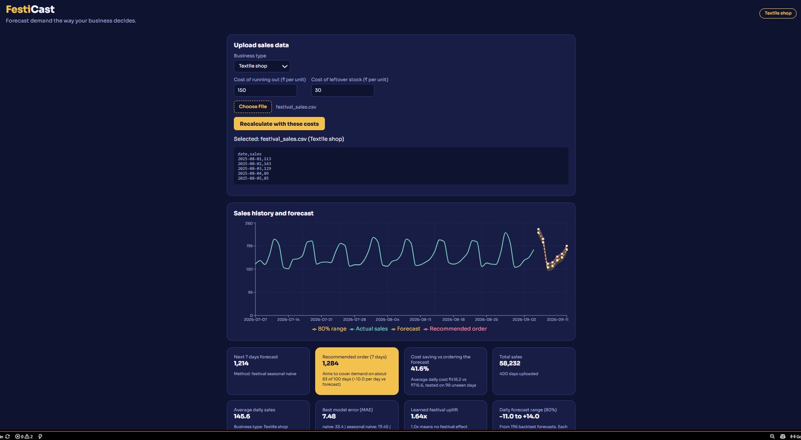

# FestiCast

**Decision-aware and festival-aware demand forecasting for Indian small businesses.**

Small shops lose money in two ways: they run out of stock and miss sales, or they over-order and are left with waste. Most forecasting tools only minimise statistical error and ignore both Indian festival demand and the real cost of a wrong order. FestiCast forecasts the next 7 days of sales, learns the festival effect from past data, shows how uncertain the forecast is, and turns it into a recommended order quantity based on the shop's own costs.



## What it does

1. Upload a sales CSV (`date,sales`) and pick a business type.
2. Four forecasting models are compared with a rolling backtest, and the one with the lowest error (MAE) is used automatically.
3. A festival-aware model learns how much sales rise on festival days (from `festivals.json`) and applies that to future festival days.
4. An 80% prediction interval is built from the winning model's backtest errors and drawn as a band on the chart.
5. The user enters two costs: the cost of running out and the cost of leftover stock (Rs per unit). A newsvendor rule uses them to recommend an order quantity, and the saving is tested on days the rule has not seen.

6. The dashboard shows history, the forecast, the 80% band and the recommended order on one chart, and highlights a "Festival window" when the forecast days fall inside a festival listed in `festivals.json`.

## Design

A dark midnight-indigo theme with a gold accent (the gold striped band at the top is a nod to Kerala kasavu borders), mint for actual sales, gold for the forecast and rose for the recommended order. The font is Sora. The main answer, the recommended order, is the solid gold card.

## Architecture

```
React (Vite)  ->  Node.js + Express  ->  Python FastAPI
dashboard         upload, validation,      forecasting models, backtest,
and charts        routing                  intervals, decision layer
```

| Folder | Role |
|---|---|
| `frontend/` | React dashboard: upload card, cost inputs, chart (Recharts), metric cards |
| `backend/` | Express API that validates the upload and calls the ML service |
| `ml-service/` | FastAPI service with the models, backtesting, intervals and decision layer |
| `data/` | Local CSV files (git-ignored, see "Sample data" below) |

## Methods

- **Baselines:** naive, seasonal naive (same as last week), moving average.
- **Festival-aware model:** learns an uplift factor from past festival days, removes it from last week's data, then re-applies it on future festival days.
- **Backtesting:** rolling-origin evaluation. Each model only sees data before the cut-off, and the average absolute miss (MAE) is compared across models.
- **Prediction intervals:** the 10th and 90th percentile of the winning model's backtest misses, added to each forecast day.
- **Decision layer:** newsvendor critical ratio = cost of running out / (cost of running out + cost of leftover). The order is the forecast plus the matching percentile of past misses. The saving is measured on a held-out second half of the backtest.

## Results on synthetic data

> These results come from **synthetic data generated by this repo**, with a built-in festival boost of 1.6x. They show that the code works and recovers a known effect. They are **not** evidence about real shops.

| Test | Result |
|---|---|
| Learned festival uplift (400-day synthetic file) | 1.64x (true value used to generate: 1.6x) |
| MAE, festival-aware model | 7.48 |
| MAE, seasonal naive | 19.45 |
| MAE, moving average / naive | 30.25 / 33.40 |
| Same models on a file with no festival dates | festival model ties seasonal naive (MAE 11.12), as it should |
| 80% interval coverage on 84 unseen days | 71 of 84 days inside the band (85%) |
| Order cost saving, textile-style costs (Rs 150 / Rs 30) | 41.6% |
| Order cost saving, bakery-style costs (Rs 40 / Rs 60) | 2.1% |
| Order cost saving, equal costs (Rs 50 / Rs 50) | -0.5% (no benefit when both mistakes cost the same) |

## Limitations

- Only synthetic data has been tested so far. Real shop data is the next step.
- The festival dates in `ml-service/festivals.json` are **example windows** for the synthetic data, not real calendar dates. Replace them with verified dates for each year before using real data.
- The interval has the same width on every day, including festival days, which are likely harder to predict.
- The decision layer ignores current stock, delivery time and minimum order sizes, and applies one offset to every day.
- Daily data with one row per day and no gaps is assumed.

## Run it locally

You need Node.js 18+ and Python 3.10+. Start each service in its own terminal.

**1. ML service**

```bash
cd ml-service
python -m venv venv
source venv/Scripts/activate      # Git Bash on Windows. On macOS/Linux: source venv/bin/activate
pip install -r requirements.txt
uvicorn main:app --reload --port 8000
```

**2. Backend**

```bash
cd backend
npm install
npm run dev
```

**3. Frontend**

```bash
cd frontend
npm install
npm run dev
```

Open http://localhost:5173/ and upload a CSV.

## Sample data

CSV files are git-ignored, so generate them locally (with the ML virtual environment active):

```bash
cd ml-service
python make_festival_data.py     # data/festival_sales.csv  (400 days, 3 festivals)
python make_sample_data.py       # data/long_sales.csv      (120 days, no festival dates)
```

## Tests

With the ML service running:

```bash
cd ml-service
python test_forecast.py     # model comparison and festival uplift checks
python test_interval.py     # prediction interval coverage on unseen days
python test_decision.py     # order quantity changes with the cost inputs
```

## Roadmap

- [ ] Evaluate on festival days vs normal days separately, plus an ablation study
- [ ] LightGBM and other ML challenger models
- [ ] Test on real shop sales data with verified festival dates
- [ ] Separate prediction interval for festival days, and conformal prediction
- [ ] Anomaly detection and explanations (SHAP)
- [ ] 30 and 90 day horizons
- [ ] Docker setup and a live demo

## Tech stack

React, Vite, Recharts, Node.js, Express, Python, FastAPI, Pydantic, Uvicorn.
